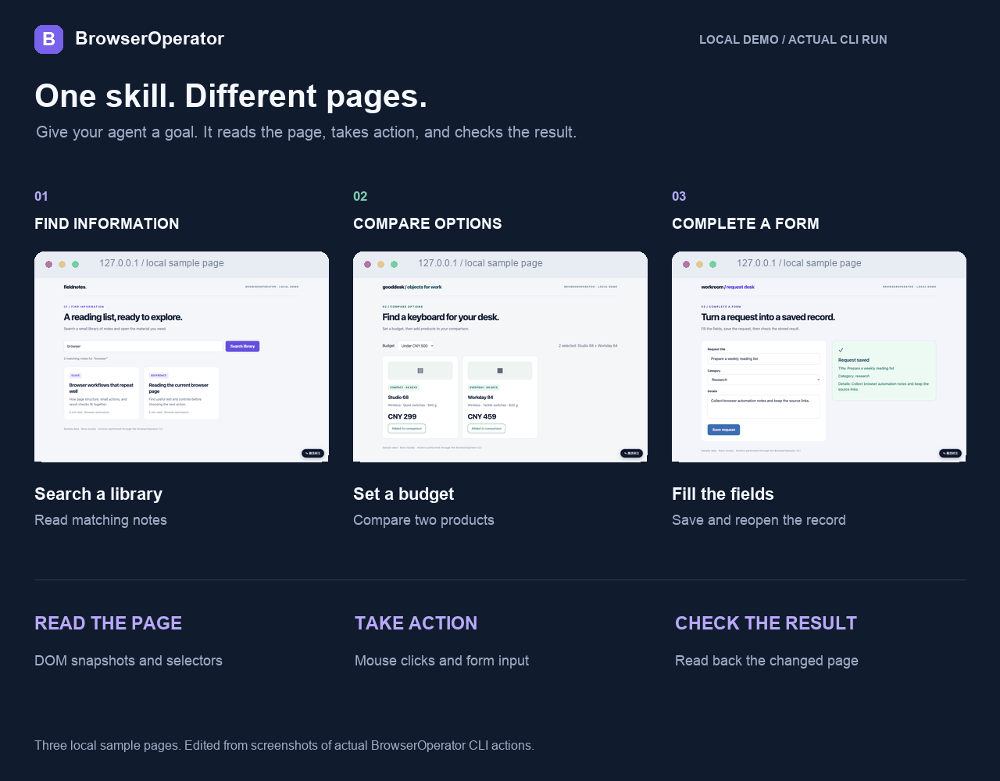

<h1 align="center">BrowserOperator</h1>

<p align="center"><strong>One skill. Different websites. Your agent handles the task.</strong></p>

<p align="center">
  <a href="README_CN.md">中文</a> ·
  <a href="#how-it-adapts-to-different-websites-and-tasks">How it adapts</a> ·
  <a href="#quick-start">Quick start</a> ·
  <a href="#things-to-try">Things to try</a> ·
  <a href="skills/browser-operator/references/usage.md">User guide</a>
</p>

Research a topic, compare products, collect job descriptions, or fill out a form in your dashboard. Give your agent a goal and let it work through the pages.

BrowserOperator gives your agent control of local Chrome. It reads the current page, finds controls and content, then combines clicks, form input, selections, dragging, and tab switching. On a different site or task, the agent can inspect the page again, choose its steps, and check the result.



*Three local sample pages with different layouts, edited from screenshots of actual CLI actions: search and read results, filter and select products, then fill a form and reopen the page to check the saved record.*

## How it adapts to different websites and tasks

**Start with the page in front of you.** BrowserOperator uses Playwright and the Chrome DevTools Protocol to read page structure (the DOM), returning text, element attributes, and locators. The agent uses that information to choose its next action, so the same tools work across different sites. When a page changes, it can inspect the structure again and adjust the steps.

**Combine small actions into a task.** Reading, searching, filling forms, dragging, and working with tabs and iframes can be combined: open details from a list, collect information from several pages, or fill a form and query the result again. You describe the goal and how to check it; the agent plans the steps.

**Keep verified procedures for later.** The skill tells the agent to save entry points, selectors, ways to read results, and common problems. Later sessions consult those notes first. After the same task succeeds over several runs, its steps can become a recipe with parameters.

BrowserOperator provides browser actions and tools for keeping notes. Your chosen agent understands the task and plans the work. Success still depends on its judgment, the page structure, and the access available.

## Quick start

### Install

Ask your agent to install this repository into its skills directory:

> Install the browser-operator skill from https://github.com/LearnAIHubC/BrowserOperator.git, install its dependencies, and tell me how to start using it after restarting.

Or run this in a terminal:

```bash
npx --yes github:LearnAIHubC/BrowserOperator
```

The installer defaults to `${DSH_HOME:-$HOME/.dsh}/skills/browser-operator`, installs dependencies, and creates a launcher. For an agent with a different skills directory, pass its parent directory with `--dest`. The installer creates `browser-operator/` inside it:

```bash
npx --yes github:LearnAIHubC/BrowserOperator --dest /path/to/your-agent/skills
```

Restart your agent so it loads the skill. To update an installation, add `--force` to the original command. See the [user guide](skills/browser-operator/references/usage.md) for other options.

### Try a task

Choose a site you use and describe what to do and what to check:

> Use BrowserOperator to open the site I specify, search for a keyword, and read the first three results in detail. Collect their titles, key points, and source links. After succeeding, save the site's procedure for next time.

### Requirements

- Node.js 20 or later, npm, and Google Chrome. Set `CHROME_PATH` if you need to specify Chrome's location.
- An agent that can read skills and execute local commands.
- macOS, Linux, or Windows. The launcher uses Bash, so Windows needs an environment such as Git Bash. Without Bash, run `node <skill-directory>/scripts/browser.mjs ...` directly.

## Things to try

These are task examples. Substitute your own sites, materials, and requirements.

### Research across several pages

> Find material about browser automation on the sites I specify. Open and read each page, group the main points by use, and keep the source links. Mark information that is not published as “not specified.”

### Compare products that fit your needs

> Compare three mechanical keyboards under CNY 500. Read the product details and list prices, layouts, switches, connectivity, and product links. Explain the main differences.

### Find jobs and tailor a resume to your actual experience

> Find Java backend roles in Shanghai, prioritizing positions asking for 3–5 years of experience and paying CNY 20–30K per month. Collect the JDs and original links, then use my resume to highlight relevant experience. List skill gaps separately; do not invent projects or work history.

BrowserOperator handles browsing and reading. Your agent uses the information and materials you provide to organize findings, compare options, or rewrite a resume.

### Update a dashboard and check the saved result

> Open the test dashboard, find the specified record, update its notes with the text I provide, and save. Reopen the details to confirm the change, capture key screenshots, and restore the test data afterward.

The same tools can support development and operations tasks, such as UI regression checks or reading GitLab pipelines and failed job logs. Check whether a released application works using the project's existing verification procedure.

### Point to the part of the page you mean

> Open a visible browser window so I can mark the area I want to work with. Read my selection, tell me which text and controls are inside it, then continue with my instructions.

Use the “圈选标注” button at the bottom right to draw a rectangle. The agent calls `annotate read` to read elements, text, CSS selectors, and positions in the selected area. The annotation setting is saved and remains in effect across navigation and browser restarts.

## Less repeated work on later visits

### Read saved notes before exploring a site

Entry points, search controls, result lists, ways to read details, and common problems are saved in local Markdown files for later sessions. Notes for the same app in different environments can be linked; URLs, accounts, and institution IDs still need checking in the current environment.

### Change parameters and repeat a familiar task

On the third successful run of the same task, the skill tells the agent to save verified steps as a recipe. Later, change the search term, environment, branch, or version and execute the steps with `recipe run`.

The agent writes and maintains recipes; the CLI substitutes parameters and runs the steps. If a step fails, execution stops and the current page stays open for you or the agent to continue. Site changes can require updates to the recipe.

### Keep your login state

Use separate browser profiles for sites or accounts to save cookies and local storage. Later visits can reuse a login while its session remains valid.

Chrome runs headlessly by default. When it detects login or verification while opening a page, it switches to a visible window. Sites using session cookies can enable `restore-session`; recovery after a restart still depends on a valid server-side session. See [login persistence](skills/browser-operator/references/usage.md#login-persistence).

### Inspect failures with page and request records

Before clicking, the tool checks whether the element can be operated and whether it is covered. Commands report page changes; the agent still needs to check the actual result, such as saved data or a success message.

For diagnosis, `debug` collects page state, a screenshot, and recent Console and Network records. Network records contain request URLs, status, timing, and failure reasons. Request headers and bodies are not recorded by default.

## Before you use it

- By default, you log in through the visible browser window. The agent can perform login actions only when you explicitly ask it to in the current conversation. You always complete sliders and CAPTCHAs yourself. Detection uses page features and can be wrong, so check the actual page state.
- Each profile keeps a stable browser fingerprint, with adjustments for some automation checks and false positives from developer-tools detection. Sites can still restrict access under their own rules.
- Pages with limited DOM information or unusual controls may need extra handling. Changed layouts, pop-ups, and loading behavior can invalidate saved steps.
- Browser data, default screenshots, site notes, recipes, annotation records, and logs are stored locally. The default data directory is `~/.dsh/browser-operator/`.

## Learn more

- [User guide](skills/browser-operator/references/usage.md): manual installation, full commands, login recovery, data locations, and configuration.
- [Skill instructions](skills/browser-operator/SKILL.md): procedures and rules for the agent.
- [Site experience template](skills/browser-operator/references/experience-template.md) · [Recipe template](skills/browser-operator/references/recipe-template.md): save verified procedures.
- [Demo cover](skills/browser-operator/references/assets/browser-operator-cover.png): a static image for sharing the project.

<details>
<summary>See a command-line example</summary>

Your agent normally runs the commands. This example uses the default installation directory; change `BROWSER` if you installed elsewhere:

```bash
BROWSER="${DSH_HOME:-$HOME/.dsh}/skills/browser-operator/bin/browser"

# Read saved site knowledge before opening the page
"$BROWSER" experience show example.com
"$BROWSER" open "https://example.com" --profile example

# Inspect interactive elements, read content, and save a screenshot
"$BROWSER" snapshot --mode interactive --profile example
"$BROWSER" query "h1" --profile example
"$BROWSER" screenshot --profile example --full-page

# Close the browser and save the profile
"$BROWSER" stop --profile example
```

Use the locators returned by `snapshot` for later actions. After each step, check the page changes and the actual result.

</details>

<details>
<summary>How does it compare with Codex's browser tools?</summary>

BrowserOperator can be installed as a skill in agents such as Codex, providing local Chrome control, site notes, and workflow replay. The agent needs to read skills and execute local commands.

Codex has several browser-control options. On macOS, controlling desktop apps through Computer Use requires Screen Recording and Accessibility permissions. Its built-in browser or connected Chrome can also inspect the DOM, Console, and Network with developer mode enabled and the appropriate access approved.

| Area | BrowserOperator | Codex's browser tools |
| --- | --- | --- |
| Entry point | A separate skill and CLI through which an agent operates local Chrome | Built-in browser, browser extension, or Computer Use, depending on the selected entry point |
| Elements and debugging | Playwright / CDP for DOM inspection, element targeting, Console, and Network | Browser developer mode can also inspect DOM, Console, and Network with approval; desktop app control uses operating-system capabilities |
| Sessions | Named profiles keep browser data separate for sites or accounts | The built-in browser uses its own profile; the browser extension can connect to a regular browser session |
| Knowledge and replay | The skill specifies reading and updating site notes, with recipes that accept parameters for repeated tasks | Installed skills can extend workflows; the rules depend on the current tools and configuration |

For current Codex capabilities and permissions, see OpenAI's official [browser documentation](https://learn.chatgpt.com/docs/browser) and [Computer Use documentation](https://learn.chatgpt.com/docs/computer-use).

</details>

---

[MIT License](LICENSE)
