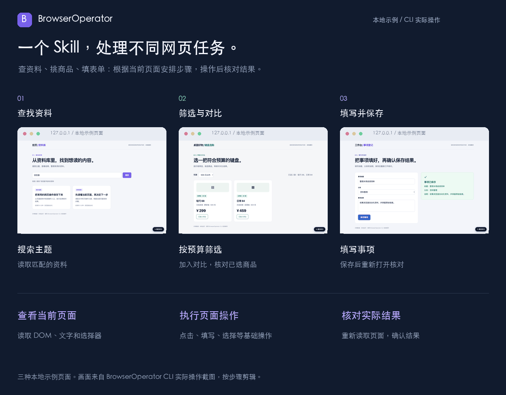

<h1 align="center">BrowserOperator</h1>

<p align="center"><strong>一个 Skill，让 Agent 处理不同网站上的网页任务。</strong></p>

<p align="center">
  <a href="README.md">English</a> ·
  <a href="#为什么能处理不同网站和任务">怎样适应不同网页</a> ·
  <a href="#快速开始">快速开始</a> ·
  <a href="#可以直接这样用">任务示例</a> ·
  <a href="skills/browser-operator/references/usage_CN.md">使用指南</a>
</p>

查资料、比较商品、整理招聘信息、填写后台表单，你可以把目标交给 Agent，让它到网页上完成操作。

BrowserOperator 为 Agent 提供本地 Chrome 操作能力：读取当前页面结构，找到按钮、输入框和内容，再组合点击、填写、选择、拖拽、切换标签页等操作。换一个网站或任务，Agent 可以重新查看页面、安排步骤，并检查结果。



*演示使用三种结构不同的本地示例页面，由实际 CLI 操作截图剪辑而成：搜索并读取结果、筛选并选择商品、填写表单后重新打开确认保存。*

## 为什么能处理不同网站和任务？

**从当前页面找操作方法。** BrowserOperator 通过 Playwright 和 Chrome DevTools Protocol 读取页面结构（DOM），返回文字、元素属性和定位信息。Agent 根据眼前的页面决定下一步，因此这套操作能力可以用于不同站点。页面变化后，也可以重新读取结构、调整步骤。

**把基础操作组合成任务。** 阅读、搜索、填表、拖拽、多标签页和 iframe 操作可以配合使用：从列表打开详情、把几页信息整理在一起，或填写表单后重新查询。你说明目标和完成条件，具体步骤由 Agent 安排。

**把验证过的方法留给下次。** Skill 要求 Agent 保存站点入口、选择器、结果读取方式和常见问题。下次先参考已有经验；同一任务多次成功后，再把步骤保存为带参数的操作脚本。

BrowserOperator 提供浏览器操作和记录工具，任务理解与步骤规划由你使用的 Agent 完成。能否完成具体任务，仍取决于 Agent 的判断、页面结构和当前访问权限。

## 快速开始

### 安装

让你的 Agent 安装这个仓库，并放到它使用的 Skill 目录：

> 安装 https://github.com/LearnAIHubC/BrowserOperator.git 中的 browser-operator Skill，安装依赖，并告诉我重启后怎么开始使用。

也可以在终端运行：

```bash
npx --yes github:LearnAIHubC/BrowserOperator
```

默认安装到 `${DSH_HOME:-$HOME/.dsh}/skills/browser-operator`，并安装依赖、创建启动器。如果你的 Agent 使用其他 Skill 目录，用 `--dest` 指定其父目录，安装器会在其中创建 `browser-operator/`：

```bash
npx --yes github:LearnAIHubC/BrowserOperator --dest /path/to/your-agent/skills
```

安装完成后重启 Agent，让它加载 Skill。更新已有安装时，在原命令后追加 `--force`。其他选项见[使用指南](skills/browser-operator/references/usage_CN.md)。

### 试一个任务

选一个你常用的网站，说清要做什么、怎样算完成：

> 使用 BrowserOperator 打开我指定的网站，按关键词搜索，查看前三条结果的详情，整理标题、要点和原始链接。成功后保存这个站点的操作经验。

### 环境要求

- Node.js 20 及以上、npm，以及已安装的 Google Chrome。也可以通过 `CHROME_PATH` 指定 Chrome 的位置。
- Agent 能读取 Skill，并执行本地命令。
- 支持 macOS、Linux 和 Windows。启动器使用 Bash，Windows 需要 Git Bash 等环境；无 Bash 时可直接运行 `node <Skill 目录>/scripts/browser.mjs ...`。

## 可以直接这样用

下面是任务示例，可以换成你自己的站点、资料和条件。

### 查资料，把不同页面的信息放到一起

> 在我指定的几个网站查找浏览器自动化相关资料，逐篇打开阅读，按用途整理主要观点，保留来源链接。没有写明的信息标注为“未注明”。

### 挑商品，比较你在意的条件

> 帮我比较三款预算 500 元以内的机械键盘，查看商品详情，整理价格、配列、轴体、连接方式和商品链接，说明每款的主要差异。

### 找岗位，再按真实经历调整简历

> 查找上海的 Java 后端岗位，优先看要求 3～5 年经验、月薪 20～30K 的职位。整理 JD 和原始链接，再结合我的简历突出相关经历，缺少的技能单独列出，不编造项目或工作经历。

BrowserOperator 负责网页查询和读取；整理资料、比较内容和改写简历，由 Agent 结合你提供的材料完成。

### 操作后台，保存后再核对

> 打开测试后台，搜索指定记录，按我提供的内容修改备注并保存。重新打开详情确认修改结果，保存关键步骤截图，最后恢复测试数据。

开发和运维任务也可以使用这套操作能力，例如执行页面回归用例、查看 GitLab 流水线和失败日志。发布后的应用是否可用，需要按项目已有的检查方法另行确认。

### 说不清页面上的哪一块，就框出来

> 打开可见的浏览器窗口，我会框选需要处理的内容。读取我的标注，告诉我框内有哪些文字和可操作元素，再按我的要求继续。

页面右下角的“圈选标注”按钮可以拖出矩形框。Agent 通过 `annotate read` 读取框内元素、文字、CSS 选择器和位置，帮助理解你指的是哪里。标注开关会保存，之后打开页面或重启浏览器仍按你的设置显示。

## 日常使用时，还能省下哪些重复操作？

### 常用站点，先读经验再操作

入口、搜索框、结果列表、详情读取方法和常见问题保存在本地 Markdown 中，新会话也能继续参考。同一应用在不同环境中的经验可以关联查看；URL、账号、机构代号等仍需按当前环境确认。

### 做过多次的流程，换参数再执行

同一任务第 3 次成功执行时，Skill 要求 Agent 把验证过的步骤整理成操作脚本（recipe）。以后可以换搜索词、环境、分支或版本，通过 `recipe run` 执行。

脚本由 Agent 编写和维护，CLI 负责替换参数、执行步骤。某一步失败后会停止，保留当前页面，供你或 Agent 继续处理。页面改版后，仍需检查并更新脚本。

### 保留登录状态，减少重复登录

每个站点或账号可以使用独立的浏览器资料（Profile），保存 Cookie 和本地存储。登录会话仍有效时，下次可以继续使用。

Chrome 默认无界面运行；打开页面时识别到需要登录或验证，会切到可见窗口。依赖会话 Cookie 的站点可以开启 `restore-session`，跨重启恢复仍取决于服务端会话是否有效，详见[登录持久化](skills/browser-operator/references/usage_CN.md#登录持久化)。

### 出错时，有页面和请求记录可查

点击前会检查元素是否能操作、是否被遮挡。命令会报告页面变化，Agent 还需核对保存结果、提示文字等实际结果。

遇到问题时，`debug` 可以收集页面状态、截图、近期 Console 和 Network 记录。Network 记录包含请求地址、状态、耗时和失败原因，默认不记录请求头或请求体。

## 使用前了解这些

- 登录默认由你在可见窗口中完成。只有你在当前对话明确要求代登录时，Agent 才能执行相关操作；滑块和 CAPTCHA 始终由你完成。页面特征检测可能误判，仍需检查实际状态。
- 浏览器指纹在同一个 Profile 中保持稳定，并针对部分自动化检测和开发者工具检测误报做了适配。网站仍可能按自身规则限制访问。
- DOM 信息不足的页面或特殊控件可能需要额外处理。页面改版、弹窗和加载方式变化，也可能使旧步骤失效。
- 浏览器资料、默认截图、站点经验、操作脚本、标注记录和日志保存在本机。默认数据目录为 `~/.dsh/browser-operator/`。

## 进一步了解

- [使用指南](skills/browser-operator/references/usage_CN.md)：手动安装、完整命令、登录恢复、数据目录与配置。
- [Skill 说明](skills/browser-operator/SKILL.md)：Agent 使用浏览器时的流程与规则。
- [站点经验模板](skills/browser-operator/references/experience-template.md) · [操作脚本模板](skills/browser-operator/references/recipe-template.md)：保存已验证的操作方法。
- [中文演示封面](skills/browser-operator/references/assets/browser-operator-cover-cn.png)：可用于分享项目的静态图片。

<details>
<summary>查看命令行操作示例</summary>

通常由 Agent 执行命令。下面使用默认安装目录；如果安装在其他位置，请修改 `BROWSER`：

```bash
BROWSER="${DSH_HOME:-$HOME/.dsh}/skills/browser-operator/bin/browser"

# 先读取已有站点经验，再打开页面
"$BROWSER" experience show example.com
"$BROWSER" open "https://example.com" --profile example

# 查看可操作元素，读取页面内容并保存截图
"$BROWSER" snapshot --mode interactive --profile example
"$BROWSER" query "h1" --profile example
"$BROWSER" screenshot --profile example --full-page

# 关闭浏览器并保存 Profile
"$BROWSER" stop --profile example
```

后续操作使用 `snapshot` 返回的定位信息。每一步完成后，仍需检查页面变化和实际结果。

</details>

<details>
<summary>和 Codex 自带的浏览器操作有什么区别？</summary>

BrowserOperator 可以作为 Skill 安装到 Codex 等 Agent 中，提供本地 Chrome 操作、站点经验和流程重放能力。Agent 需要能读取 Skill 并执行本地命令。

Codex 有多种浏览器操作入口。在 macOS 上，通过 Computer Use 控制桌面应用时需要屏幕录制和无障碍权限；内置浏览器或连接的 Chrome 在启用开发者模式并获得相应授权后，也能查看 DOM、Console 和 Network。

| 对比项 | BrowserOperator | Codex 自带的浏览器操作 |
| --- | --- | --- |
| 使用入口 | 独立 Skill 和命令行工具，由 Agent 调用本地 Chrome | 内置浏览器、浏览器扩展或 Computer Use，取决于所用入口 |
| 元素与调试 | 通过 Playwright / CDP 读取 DOM、定位元素，查看 Console 和 Network | 浏览器开发者模式在相应授权后也可查看 DOM、Console 和 Network；桌面应用操作使用系统控制能力 |
| 会话管理 | 通过命名 Profile 分别保存站点或账号的浏览器资料 | 内置浏览器使用独立资料；浏览器扩展可以连接日常浏览器会话 |
| 经验与重放 | Skill 要求先读后写站点经验，并将重复任务整理为带参数的 recipe | 可通过所装 Skill 等方式扩展流程，具体规则由当前工具与配置决定 |

Codex 当前能力和权限设置以 OpenAI 官方的[浏览器说明](https://learn.chatgpt.com/docs/browser)与 [Computer Use 说明](https://learn.chatgpt.com/docs/computer-use)为准。

</details>

---

[MIT License](LICENSE)
